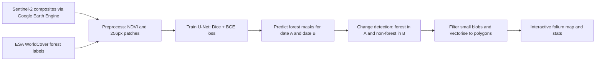

# Deforestation Detection from Sentinel-2 Satellite Imagery

  

A deep-learning pipeline that maps forest cover with a **U-Net** segmentation model, compares two dates, and flags **newly cleared areas** on an interactive map. It uses only free data (Sentinel-2 and ESA WorldCover), so anyone can reproduce it for any region.

> Add a screenshot of your map here: `docs/map_preview.png`

## How it works



1. **Data**: Sentinel-2 L2A median composites (bands B2, B3, B4, B8; clouds masked with the SCL band) for a training period and two comparison dates, all from the same season.
2. **Labels**: forest mask (tree cover class) from ESA WorldCover 2021.
3. **Model**: U-Net trained on 256×256 patches with 5 channels (4 bands + NDVI), Dice + binary cross-entropy loss to handle class imbalance.
4. **Evaluation**: train/val/test split by **spatial block**, not random patches, so neighbouring patches cannot leak between sets.
5. **Change detection**: `forest(A) = 1` and `forest(B) = 0` marks clearing. Speckle and regions below a minimum area (default 0.5 ha) are removed.
6. **Output**: GeoJSON polygons with area in hectares, summary stats, and an interactive map with layer toggles.

## Results

Fill these in after you run the pipeline on your area (`outputs/metrics.json`, `outputs/stats.json`).

| Metric (held-out test blocks) | Value |
|---|---|
| Forest IoU | _your result_ |
| F1 score | _your result_ |
| Precision / Recall | _your result_ |

| Change detection (A → B) | Value |
|---|---|
| Study area | _e.g. Koyna region, Western Ghats_ |
| Forest loss | _your result_ ha |

## Quick start

```bash
git clone https://github.com/<your-username>/deforestation-detection.git
cd deforestation-detection
python -m venv .venv && source .venv/bin/activate   # Windows: .venv\Scripts\activate
make install            # or: pip install -r requirements.txt && pip install -e .
```

### 1. Get the data (Google Earth Engine, free)

1. Sign up for Earth Engine (non-commercial use is free) and create a Google Cloud project.
2. Put your project ID and study area in `config.yaml` (`gee_project`, `aoi`, `crs`).
3. Run:
   ```bash
   earthengine authenticate
   python -m deforestation.gee_download --config config.yaml
   ```
4. When the tasks finish (see the Earth Engine Tasks tab), download these files from your Drive folder into `data/raw/`:
   `train_image.tif`, `train_label.tif`, `A_image.tif`, `B_image.tif`

### 2. Run the pipeline

```bash
make preprocess   # patches + spatial split
make train        # trains U-Net, writes metrics + figures
make predict      # forest masks for dates A and B
make change       # newly cleared areas (GeoTIFF, GeoJSON, stats)
make map          # outputs/forest_loss_map.html
```

Open `outputs/forest_loss_map.html` in a browser.

## Project structure

```
├── config.yaml                  # area, dates, hyperparameters
├── src/deforestation/
│   ├── gee_download.py          # Earth Engine export (composites + labels)
│   ├── features.py              # bands + NDVI feature builder
│   ├── preprocess.py            # patching and spatial train/val/test split
│   ├── model.py                 # U-Net
│   ├── losses.py                # Dice + BCE loss, Dice/F1 metric
│   ├── train.py                 # training and evaluation
│   ├── predict.py               # sliding-window inference on full scenes
│   ├── change_detection.py      # loss mask, filtering, polygons, stats
│   └── visualize.py             # interactive folium map
├── tests/                       # unit tests (pytest)
├── data/                        # raw and processed data (git-ignored)
└── outputs/                     # models, masks, figures, map
```

## Known limitations

- **Clouds and haze** can create false clearing; composites use the SCL cloud mask and a median over a season.
- **Seasonal change** (leaf-off deciduous forest) can look like loss, so both dates use the same season. Always inspect flagged areas on the satellite layer.
- **Label noise**: ESA WorldCover is a 10 m global product and is not perfect locally, so the model inherits its errors.
- The model is trained on one region and period; retrain or fine-tune before using it somewhere very different.
- This is a research and portfolio project, not an official monitoring system.

## Ideas for extension

- Use Hansen Global Forest Change (`lossyear`) to validate detected loss.
- Add Sentinel-1 radar to see through clouds.
- Try pretrained encoders (e.g. a ResNet backbone) and compare against this baseline.
- Run monthly detection and plot a time series of cleared area.

## Data sources and licences

- Sentinel-2: Copernicus programme, free and open.
- ESA WorldCover 2021: CC BY 4.0, © ESA WorldCover project / Contains modified Copernicus Sentinel data.

## Resume line

> Built a deforestation monitoring pipeline using Sentinel-2 imagery, U-Net segmentation and multi-date change detection, visualized on an interactive map.

## License

MIT, see [LICENSE](LICENSE).
